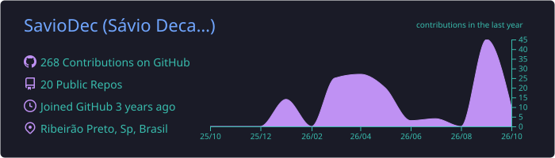
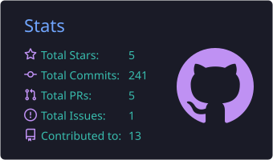
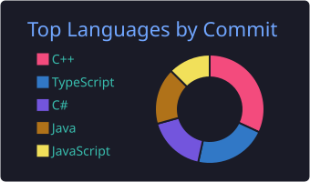
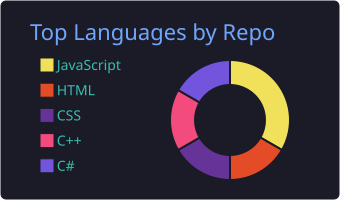
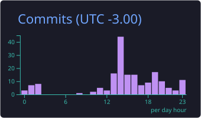

  

  

    
  

  

    
    
    
    
  

  

    
    
  

---

### Digital Presence

  <table border="0">
    <tr>
      <td width="60%">
        

          I am a <b>Software Engineering Student</b> at <b>Unaerp</b>, focused on building high-performance, scalable applications. My journey is driven by a passion for the <b>.NET ecosystem</b> and <b>Frontend excellence</b>. I specialize in bridging complex backend systems with intuitive, modern interfaces.
        

        

          Ribeirão Preto, SP - Brazil 
          Software Engineering @ Unaerp 
          Currently deepening: <b>.NET</b>, <b>Next.js</b>, real-time systems and IoT data pipelines 
          Next big focus: <b>mobile development</b> with <b>Kotlin</b> (Android) and <b>Swift</b> (iOS) 
          <i>"Building the future, one commit at a time."</i>
        

      </td>
      <td width="40%" align="center">
        
      </td>
    </tr>
  </table>

---

### Technical Arsenal

**Backend & Data**

**Mobile (my next specialization )**

**Frontend & Desktop**

**Tools & Cloud**

---

### Featured Engineering

| Project | Highlights | Stack |
| :--- | :--- | :--- |
| **[EssentialSavio](https://github.com/SavioDec/EssentialSavio)** | WhatsApp Desktop alternative for Win10 | `Electron` `JS` |
| **[SitePortfolio](https://github.com/SavioDec/SitePortfolio)** | Professional engineer portfolio | `Next.js` `TS` |
| **[Image_Resizer](https://github.com/SavioDec/Image_Resizer)** | High-performance bulk manipulation tool | `C#` `.NET` |
| **[APIRestTodoList](https://github.com/SavioDec/APIRestTodoList)** | A simple CRUD REST API application | `Java` `Spring Boot` |

  
  
  
  

---

### Mobile Roadmap

  <table>
    <tr>
      <td align="center" width="50%">
         
        <b>Android · Kotlin</b> 
        Jetpack Compose • Coroutines • MVVM
      </td>
      <td align="center" width="50%">
         
        <b>iOS · Swift</b> 
        SwiftUI • Combine • MVVM
      </td>
    </tr>
  </table>
  

---

### What I Care About

  <table>
    <tr>
      <td align="center" width="25%"><b>Clean Architecture</b> Maintainable, testable code</td>
      <td align="center" width="25%"><b>Performance</b> Optimized queries & lean UIs</td>
      <td align="center" width="25%"><b>Real-time & IoT</b> MQTT, telemetry, resilient daemons</td>
      <td align="center" width="25%"><b>Design Systems</b> Consistent, modern interfaces</td>
    </tr>
  </table>

---

### Performance Analytics

  
  
   
  
  
   
  

---

### Let's Connect

  
Open to collaborations, internships and interesting projects — let's build something great together.

  
  

   
   
  © 2026 Sávio Mariguela Decaro • Crafted for performance
  

