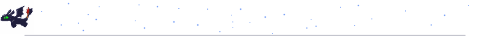

<!-- Toothless was here. If you are reading the source, you found the first egg. -->

  

  

    
    
    
    
  

  

    
    
    
    
  

  

    
    
  

---

### Digital Presence

  <table border="0">
    <tr>
      <td width="60%">
        

          I am a <b>Software Engineering Student</b> at <b>Unaerp</b>, focused on building high-performance, scalable applications. My journey is driven by a passion for <b>mobile development</b> and <b>clean, modern interfaces</b>. I specialize in bridging complex backend systems with intuitive, modern interfaces.
        

        

          Ribeirão Preto, SP - Brazil 
          Software Engineering @ Unaerp 
          Currently focused on: <b>mobile development</b> with <b>Kotlin</b> (Android) and <b>Swift</b> (iOS) 
          <i>"Building the future, one commit at a time."</i>
        

      </td>
      <td width="40%" align="center">
        
      </td>
    </tr>
  </table>

---

### Technical Arsenal

**Backend & Data**

**Mobile**

**Frontend & Desktop**

**Tools & Cloud**

$ whoami

---

### Featured Engineering

| Project | Highlights | Stack |
| :--- | :--- | :--- |
| **[Remember_it](https://github.com/SavioDec/Remember_it)** | Notes app inspired by Apple Notes, with reminders, addresses and swipe-to-delete | `Kotlin` `Android` |
| **[Keep-It-Up](https://github.com/SavioDec/Keep-It-Up)** | Reading tracker with dynamic lists, detail screens and Material Design 3 | `Kotlin` `Android` |
| **[mouse_follower_banguela_MacOs](https://github.com/SavioDec/mouse_follower_banguela_MacOs)** | Desktop pet that follows the mouse cursor on macOS | `Swift` `macOS` |
| **[SitePortfolio](https://github.com/SavioDec/SitePortfolio)** | Professional engineer portfolio | `Next.js` `TS` |

  
  
  
  

---

### Mobile Roadmap

  <table>
    <tr>
      <td align="center" width="50%">
         
        <b>Android · Kotlin</b> 
      </td>
      <td align="center" width="50%">
         
        <b>iOS · Swift</b> 
      </td>
    </tr>
  </table>
  

---

### What I Care About

  <table>
    <tr>
      <td align="center" width="33%"><b>Clean Architecture</b> Maintainable, testable code</td>
      <td align="center" width="33%"><b>Performance</b> Optimized queries & lean UIs</td>
      <td align="center" width="33%"><b>Design Systems</b> Consistent, modern interfaces</td>
    </tr>
  </table>

---

### Performance Analytics

  

  
  
   
  
  
   
  

  

### Let's Connect

  
Open to collaborations, internships and interesting projects — let's build something great together.

  
  

Psst. Click here, but do not scare him.

Toothless guards this profile. He likes fish, clean commits and long flights.

Want to see him in action? <a href="https://github.com/SavioDec/mouse_follower_banguela_MacOs">He follows your mouse on macOS</a> and <a href="https://github.com/SavioDec/mouse_follower_banguela_gnome">on GNOME</a>.

   
   
  
   
  © 2026 Sávio Mariguela Decaro • Crafted for performance
  

<!-- up up down down left right left right b a -->
